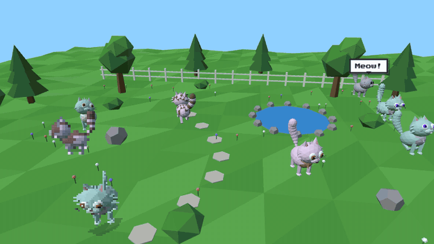
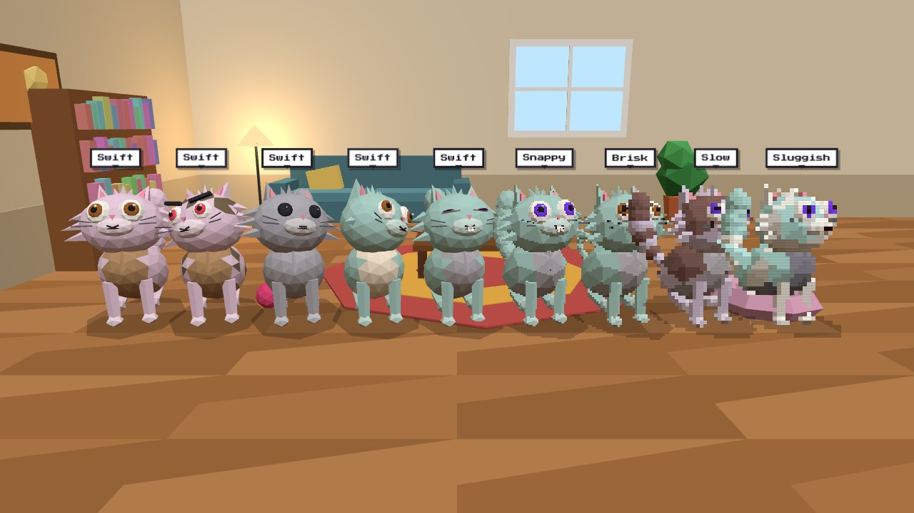
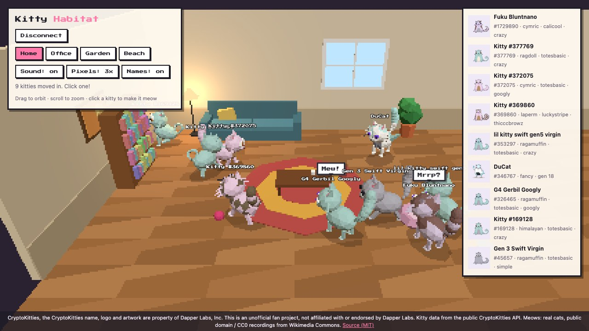
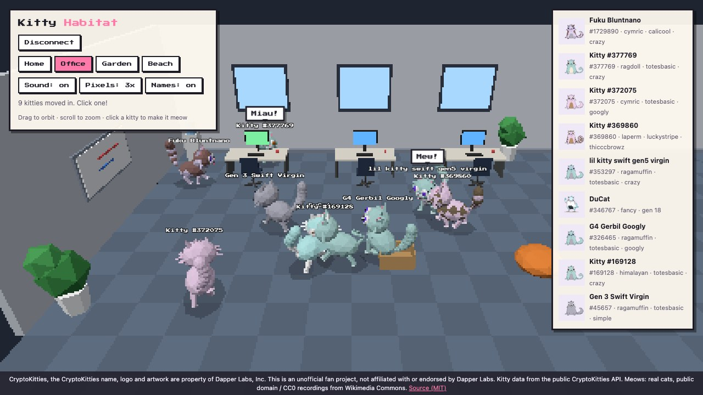
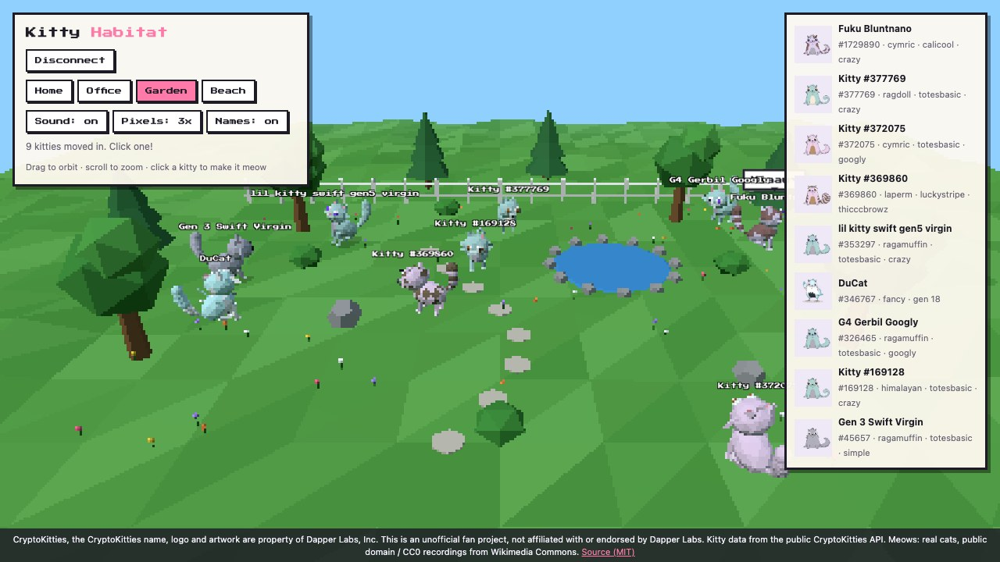
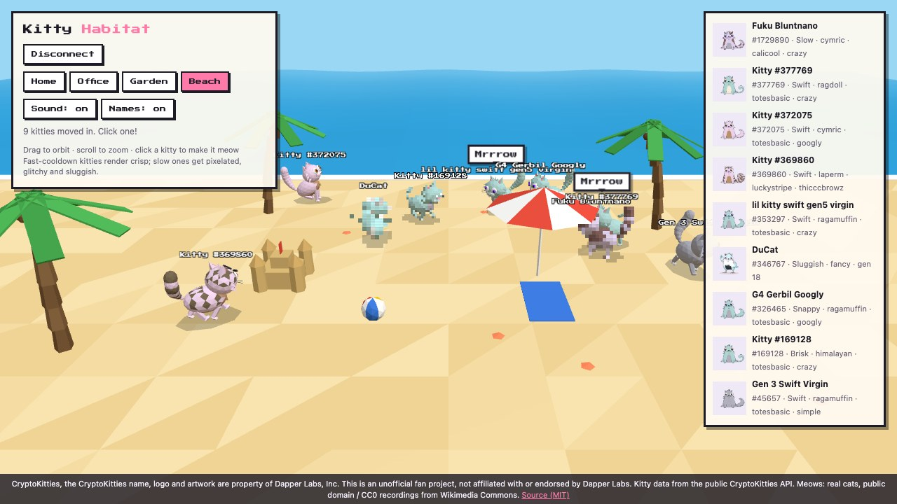

<div align="center">

# 🐾 Kitty Habitat

**Your CryptoKitties, alive in low-poly 3D. Fast cats crisp, slow cats glitched.**

Connect your wallet and every kitty you own moves into a little world of its own:
it walks around, sits, naps, gets the zoomies and meows with real cat voices.

[](https://metaver5o.github.io/kitties-habitat/)
[](LICENSE)
[](https://threejs.org/)
[](#run-it-locally)



**▶ https://metaver5o.github.io/kitties-habitat/**

</div>

---

## What it does

- **Wallet-gated.** Nothing shows until you connect a browser wallet (MetaMask or similar). Then that account's kitties load into the scene. Switch accounts and the cats switch too. Disconnect and they leave.
- **Every cat is unique.** No sprites or stock models. Each kitty is built in 3D from its own traits, so two wallets never look the same.
- **They behave like cats.** They wander, avoid furniture and each other, sit, curl up to sleep (`zZz`), hop, and get the occasional zoomies.
- **They climb furniture.** Kitties walk up to the sofa, coffee table, office desks (right in front of the keyboard) and chairs, the beanbag, the garden bench and rocks, the sandcastle and the beach cooler, jump up, sit or nap there for a while, then hop back down. Each surface has room for a set number of cats.
- **Real meows.** Each kitty has its own set of real cat recordings and its own pitch. Click a kitty, or its card in the roster, to make it meow, or to wake it up.
- **Petting.** Press and hold on a kitty to pet it: it sits still, squints, tilts its head into your hand and purrs (a real recorded purr, pitched to its voice).
- **Toys.** Each scene has a ball (yarn at home and in the garden, a paper ball in the office, a beach ball at the beach). Kitties chase it and bat it around on their own. Click the ball to throw it and the nearest kitties give chase.
- **Four scenes.** Home, office, garden and beach, each with props the cats walk around (sofa, desks, a pond they won't step into, sandcastles).
- **Day and night.** `Time: auto` follows your local clock: the sun and moon cross the sky, windows go dark, lamps come on, stars and garden fireflies come out, and kitties nap more at night. `day` / `night` pin it, `cycle` plays a whole day in 3 minutes.
- **Cooldown decides quality.** Fast kitties render crisp and smooth. Slow ones turn chunky, pixelated, glitchy and sluggish (see [Cooldown settings](#cooldown-settings)).

## Cooldown settings

Every CryptoKitty has an on-chain breeding cooldown (`cooldown_index`, 0–13). Kitty Habitat uses it to decide how each cat is drawn and how it moves. The fastest cats get the best quality. The slowest are rendered like a corrupted old video tape.



<sub>Sorted fastest → slowest. The five Swift cats are full-resolution and anti-aliased, Snappy and Brisk start to go blocky, Slow and Sluggish are chunky pixels with glitch bursts.</sub>

| Index | Cooldown | Pixel size | Glitch | Walk speed | Animation | Mesh detail |
|---|---|---|---|---|---|---|
| 0 | Fast | 1× (native, anti-aliased) | none | 100% | every frame | high |
| 1–2 | Swift | 1× (native, anti-aliased) | none | 95–91% | every frame | high |
| 3–4 | Snappy | 2× | none | 86–82% | 30 → 28 fps | low-poly |
| 5–6 | Brisk | 3× | none | 77–72% | 25 → 23 fps | low-poly |
| 7–8 | Plodding | 4× | 14–29% | 68–63% | 20 → 18 fps | low-poly |
| 9–10 | Slow | 5× | 43–57% | 58–54% | 16 → 13 fps | low-poly |
| 11–12 | Sluggish | 6× | 71–86% | 49–45% | 11 → 8 fps | low-poly |
| 13 | Catatonic | 8× | 100% | 40% | 6 fps | low-poly |

- **Pixel size**: the cat is rendered into an offscreen target at `1/N` of the screen resolution and scaled back up with nearest-neighbour filtering. The scene itself is always full resolution.
- **Glitch**: random bursts of horizontal tearing, red/blue channel split and flicker, plus constant scanlines. Higher glitch means more frequent and stronger bursts.
- **Walk speed / animation**: slow cats walk slower, and their whole update (position, legs, tail, blinking) only advances a few times per second, which reads as choppy stop-motion.
- Occlusion still works: each pixel tier first renders a depth-only copy of the scene, so the sofa still hides a glitchy cat behind it.
- Tuning lives in `cooldownProfile()` in [`src/cat.js`](src/cat.js) (`PIXELS`, glitch, tempo, stepDt, detail).

## Your traits, in 3D

Each cattribute maps to something on the model:

| Trait | What it changes |
|---|---|
| `colorprimary` | Fur |
| `colorsecondary` | Pattern color (stripes, patches, spots, tail rings) |
| `colortertiary` | Belly and chest |
| `coloreyes` | Iris |
| `body` | Tail and fluff: **ragdoll / himalayan** get a curly tail; **cymric / laperm / ragamuffin / persian…** get a big brushy tail plus cheek and chest tufts |
| `pattern` | **luckystripe / tigerpunch…** → stripes · **calicool…** → patches · **spotted / leopard…** → spots · **spock** → face mask · **totesbasic** → plain |
| `eyes` | **googly** big eyes · **crazy** pupils looking different ways · **thicccbrowz** heavy brows · **simple** small dots · **wiley / sleepy** half-closed lids |
| `mouth` | **tongue** sticks out · **gerbil** buck teeth · **soserious** flat line · default `w` smile |

**Fancy cats** (DuCat, etc.) have no cattributes, so their palette is sampled from their official artwork. DuCats also get little wings.

## Scenes

| Home | Office |
|---|---|
|  |  |
| **Garden** | **Beach** |
|  |  |

## How it works

```
wallet (eth_requestAccounts)
   │  address only, no signatures, no transactions
   ▼
api.cryptokitties.co/kitties?owner_wallet_address=…
   │  id, name, cattributes, generation, artwork URL
   ▼
cat.js  traits ─► low-poly model (body, head, ears, eyes, mouth, legs, tail chain)
        └─ per-face vertex colors paint the pattern; no textures
   ▼
scene.js  floor bounds + furniture boxes ─► walking, collision, state machine
   ▼
renderer  scene + fast kitties at full resolution (MSAA)
          per cooldown tier: depth-only scene + tier's kitties → 1/N render target
          └─ composited on top through the glitch shader
```

- **Why the API and not the contract?** `KittyCore.tokensOfOwner()` loops over all ~2M kitties and runs out of gas on public RPCs, and CryptoKitties' `Transfer` event has no indexed fields to filter on. The public CryptoKitties API answers in one request and needs no key.
- **Privacy.** The app only reads your address. It never asks you to sign anything or send a transaction. There's no backend: everything runs in your browser.

## Run it locally

Static files, no build step, no `npm install`. Browser wallets don't inject into `file://` pages, so serve it over HTTP:

```sh
git clone https://github.com/metaver5o/kitties-habitat.git
cd kitties-habitat

docker compose up -d --build      # → http://localhost:8090
# or
python3 -m http.server 8090       # → http://localhost:8090
```

Production is GitHub Pages serving the `main` branch over HTTPS, with no CI build.

## Project layout

| Path | What |
|---|---|
| `index.html` | Page, HUD, styles, import map (three.js from jsDelivr) |
| `src/main.js` | Tiered renderer and glitch shader, time of day, wallet connection, world loop, collisions, ball physics, petting input, labels |
| `src/cat.js` | Trait → 3D model, cooldown profiles, and the walk / sit / sleep / hop / zoomies / jump / perch / chase / pet / meow behavior |
| `src/scenes.js` | Home, office, garden and beach, plus their obstacles, perches and day/night hooks (lights, windows, lamps, sun/moon, stars) |
| `src/colors.js` | CryptoKitties color gene → hex |
| `src/api.js` | CryptoKitties API client, palette sampling for fancy cats |
| `src/audio.js` | Meow and purr playback (WebAudio, per-cat clips, pitch and stereo pan) |
| `sounds/` | 12 real meows and a purr, public domain / CC0 ([credits](sounds/CREDITS.md)) |

## Ideas and contributions

PRs welcome. Some things that would be fun:

- More fancy-cat accessories and more accurate color genes (the table in `src/colors.js` is partly approximate)

## Credits and legal

- Code © 2026 Marco Matos, [MIT](LICENSE).
- **CryptoKitties, the CryptoKitties name, logo and artwork are property of Dapper Labs, Inc.** This is an unofficial fan project, not affiliated with or endorsed by Dapper Labs. No CryptoKitties artwork is stored in this repo. The 3D cats are original models driven by trait data, and the roster thumbnails load from the CryptoKitties image CDN.
- Meow and purr recordings: real cats, public domain / CC0, from Wikimedia Commons. See [sounds/CREDITS.md](sounds/CREDITS.md).
- Built with [three.js](https://threejs.org/).
